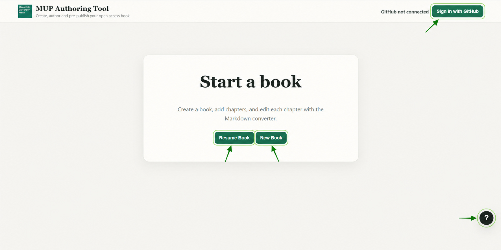
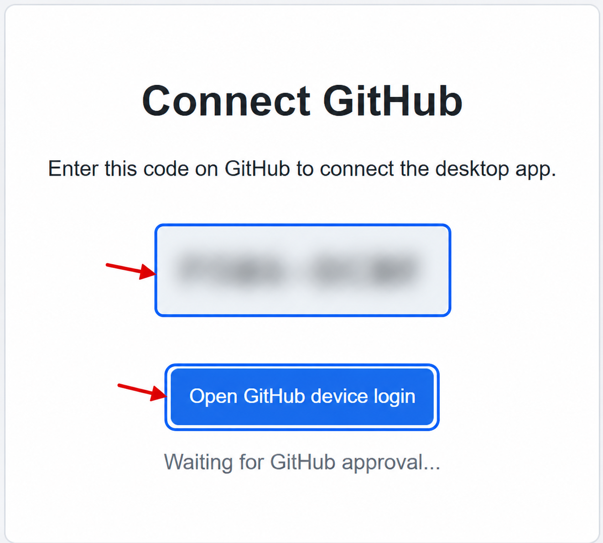

# Getting Started
## What is This App?
This app helps you write and format books using simple plain text. It converts your text into Markdown and lets you publish your book online as a TeachBook.
You can write chapters, add images and references, check your book, and publish named versions for students or collaborators to read.

## Open the App
1. Open **MUP Authoring** from the Windows Start menu or your desktop shortcut
2. The app opens the home page. If a local draft is saved, click **"Resume Book"** to continue it
3. Click the** "?"** button in the bottom-right corner whenever you want a guided tour

Before You Start
- **To write**: You need the installed app. You can create and edit a local draft without signing in
- **To publish or load a GitHub book**: You need an internet connection, a GitHub account, and access to the organization configured for your app
- **To use an existing repository**: The organization's administrator must make it available to the GitHub App, and your account must have access to it.
- **To create a new repository**: Your account must be allowed to create repositories in that organization
If you have not received the app or GitHub access, contact your administrator before starting the publishing steps.

## Sign In With GitHub

1. Click **"Sign in with GitHub"** in the top-right corner
2. On the **"Connect GitHub"** screen, note the displayed code and click "**Open GitHub device login"**
3. Sign in on GitHub, enter the code shown in the app, and approve the requested access
4. Return to the app and wait for it to finish connecting
5. Check that the top-right corner says **"Signed in as"** followed by your name
If the code expires, start sign-in again to get a new code. If sign-in reports that the app or organization is not configured, contact your administrator.
**Why GitHub?** Your published book files and versions are stored in repositories, which are folders of book files on GitHub. New book repositories are created in the organization configured for this app, rather than in your personal account. The app lists only approved repositories in that organization that your account can access and that it recognises as TeachBooks projects.
**Signing out:** Click **"Sign out" **in the top-right corner. Your local draft remains saved. You will need to sign in again to publish or load GitHub books. Closing and reopening the desktop app also requires a new GitHub sign-in.

