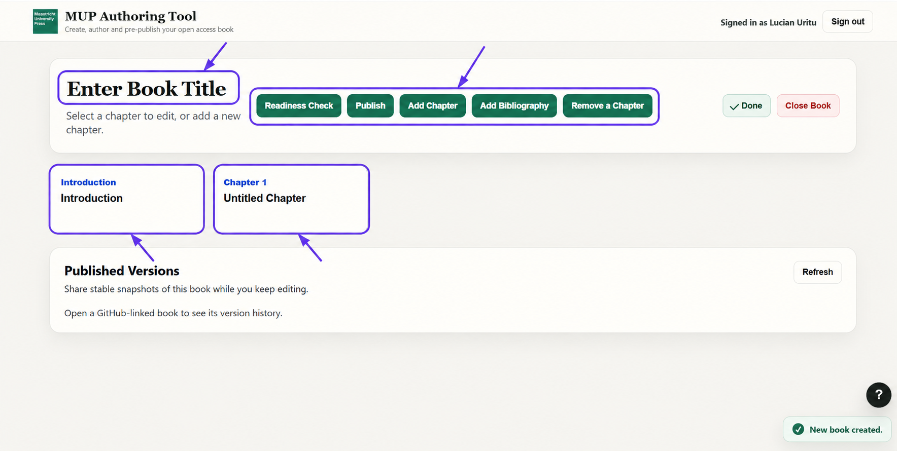

# Creating Your First Book
Step 1: Start a New Book
1. Click **"New Book" **on the home page
2. Click the **"Enter Book Title" **field on the book page
3. Type your book title. It is saved automatically as you type
Your new book already contains an **Introduction **and one chapter. You don't need to add another chapter before you start writing!
**Before starting another book:** The app keeps one current book locally. If a draft exists, New Book opens **"Replace current draft?"**. Choose **"Keep current draft"** to cancel, then **"Resume Book"** to continue writing. Choose **"Replace draft"** only after preserving unpublished work;

Step 2: Write the Introduction
1. Click the **"Introduction" **card
2. Replace the sample introduction with your own text
3. Use the title field at the top if you want to rename this section
4. Click **"← Chapters"** to return to the book page
Tip: The sample introduction is a starting point. Replace it before sharing your book.

Step 3: Add and Name Chapters
1. Click the first chapter card to open it
2. Replace "Untitled Chapter" in the title field with a descriptive title
3. Write your content in the writing area
4. Click "← Chapters" when finished
5. Click "Add Chapter" whenever you need another chapter, then open its card to name it and write

## Reorganizing Chapters
Drag a chapter card before or after another chapter card on the book page. The new order is saved automatically. The Introduction and Bibliography stay in their fixed positions.

## Removing a Chapter
1. Click **"Remove a Chapter"**
2. Click the delete control on the chapter you want to remove
3. Check the chapter name and confirm** "Delete chapter"**, or choose "Cancel"
4. Click **"Done Removing" **to leave removal mode if it is still active
**Be careful:** There is no chapter restore button. Keep a copy of content you may need later. You must keep at least one chapter; the Introduction does not count as that chapter
