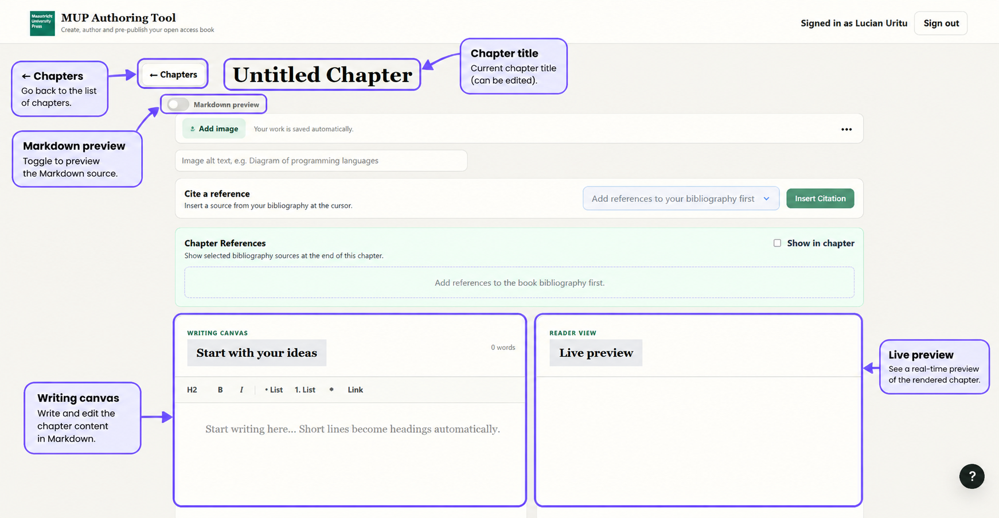

# Writing Content
## The Editor
The editor gives you a writing area and a preview:
- **Writing canvas **— Start with your ideas: Where you type or paste your content
- **Reader view **— Live preview: Shows your formatted content as you write
- **Source — Markdown:** Shows the generated Markdown when you turn on "Markdown preview"
You edit the writing canvas. The Markdown and Live preview update automatically. The word count appears above the writing area.

Basic Writing Tips
- **Start with a heading**: The converter treats the first ordinary text line as the main heading
- **Use line breaks**: Press Enter twice to separate paragraphs
- ** Short lines become headings**: Later lines of up to 10 words and 80 characters can become section headings if they do not end with a period or comma.

## Keeping a Short Line as a Paragraph
If a line becomes a heading when you don't want it to, start it with a backslash. The app removes the backslash from the output and keeps the line as ordinary text.
How to do it:
> \A short line that stays a paragraph
