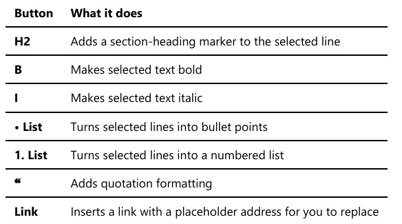

# Formatting Your Text

## Using the Formatting Toolbar
Select text or place your cursor on a line, then use the buttons above the writing area

The buttons add formatting marks to your text. Always check the Live preview after applying them.
[image] Formatting toolbar: outline the heading, bold, italic, list, quote, and Link controls above a short example.

## Bold Text
Make text stand out by wrapping it with two stars (**).
**How to do it:**

## Italic Text
Emphasize text by wrapping it with one star (*).
**How to do it:**

## Bullet Points
Create bullet points by starting each line with a dash (-) or asterisk (*) followed by a space.
Start the section with a heading before your list. This also applies to numbered lists and quotes: the converter treats the first ordinary text line as the page heading.
**How to do it:**

## Numbered Lists
Start each line with a number followed by a period or parenthesis and a space.
**How to do it:**

**or**

**Tip**: Start your content with a heading before adding a list, so the first item is not treated as the page heading

## Quotes
Add quotations by starting a line with a greater-than symbol (>).
**How to do it:**

## Section Headings
Short standalone lines are automatically detected as section headings. Leave a blank line before and after them to keep your writing easy to read.
**How to do it:**

## Links
1. Select the words you want readers to click
2. Click "Link"
3. Replace https://example.com in the inserted text with the correct address
4. Check the link in the preview and in your published book
**How to do it:**
