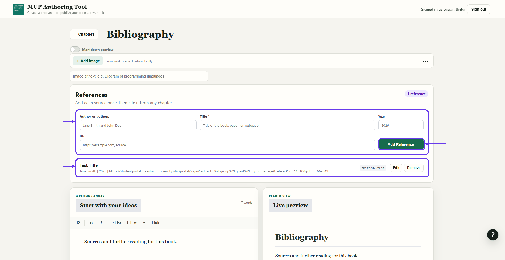
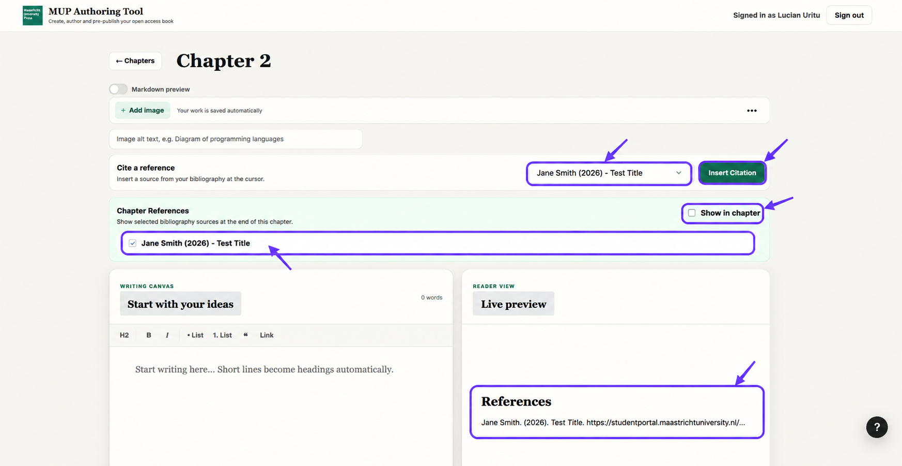

# Bibliography and Citations
## Add a Bibliography
1. Click "Add Bibliography" on the book page
2. Open the "Bibliography" card if the editor is not already open
3. In "References", enter the source's author or authors, title, year, and URL
4. Click "Add Reference"
5. Repeat for each source you want to use
Only the Title field is required. Add the other details when available so readers can identify the source. You can also write introductory text for the bibliography in its writing area.

## Edit or Remove a Reference
- **Edit: **Click **"Edit" **beside a reference, change its details, and click **"Save Reference"**
- **Cancel: **Click **"Cancel Edit" **to leave the form without saving the edit
- **Remove: **Click **"Remove" **and confirm the source you want to delete
**Tip: **Removing a reference does not remove citation text already written in chapters. Update those citations before publishing.

## Cite a Source in a Chapter
1. Open the chapter where you want to cite a source
2. Place your cursor in the writing area where the citation belongs
3. Choose a source from **"Cite a reference"**
4. Click **"Insert Citation"**
5. Check the result in the Live preview
The app inserts the citation, selects the source for that chapter, and turns on "Show in chapter" automatically.

## Show References at the End of a Chapter
In **"Chapter References"**, select the sources you want to show and turn on** "Show in chapter"**. Review the reference list in the preview. Keep sources used by the chapter's citations selected.
Do I need a bibliography? Only if your book needs references. You can publish a book without images or citations.

