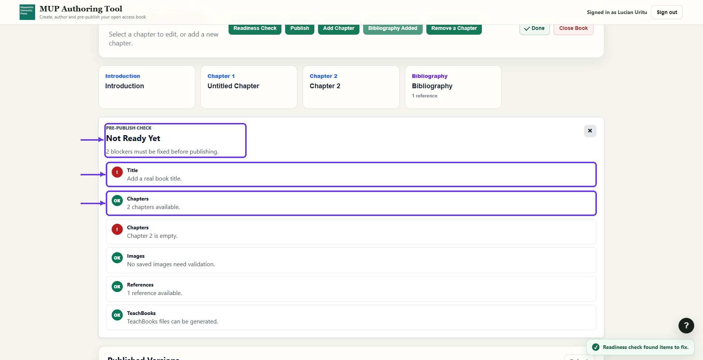

# Checking Your Book

## Run the Readiness Check
1. Click "← Chapters" to return to the book page
2. Click "Readiness Check"
3. Read the report below the chapter cards
4. Fix the listed problems, then run the check again

The check looks at the book title, chapters, images, references, and whether TeachBooks files can be generated.

- **Not Ready Yet:** One or more blockers must be fixed before publishing
- **Ready to Publish:** No blockers were found
- **Warnings: **Items to review, such as an image without alt text; these do not stop publishing
Common blockers include empty chapters, duplicate chapter titles, missing images, and citations to missing references.
**Remember: **A successful check does not proofread your book or confirm that GitHub will accept the publication. Review the content and your GitHub connection too

