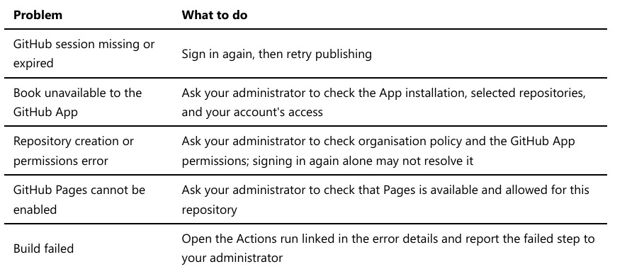

# Publishing Your Book

## What Happens When You Publish?
Publishing prepares your book files, sends them to GitHub, and starts the automated TeachBooks build. When the build succeeds, the app gives you a link to the online version.
Each new version needs a unique name. This lets you share a stable version while continuing to edit your book.

## How to Publish
1. Make sure you are signed in with GitHub
2. Run **"Readiness Check"** and fix any blockers
3. Click **"Publish"** on the book page
4. In** "Name This Published Version"**, enter a name such as **"first draft"** or **"2026 edition"**
5. Check **"Saved as"**, then click** "Publish this version"**
6. For a new book, choose** "Private"** or **"Public"** in **"Create Repository"**
7. Keep the app open and watch the publishing progress

**Button name:** After a publishing attempt, the same Publish button may be labelled "Publish Book Preview".
**Version names:** Use a short, distinctive name of up to 64 characters. Spaces become hyphens, letters become lowercase, and unsupported characters are removed. For example, **"First Draft"** is saved as** "version/first-draft"**. Check** "Saved as"** before confirming. The names main and master are not allowed; names also cannot contain consecutive periods or end in a period or .lock.

A version name that already exists cannot be used again, even if you have edited the book. Different names can become the same saved name: **"First Draft"** and **"first-draft"** both become **"version/first-draft"**.

## Choose Repository Visibility
The **"Create Repository" ** dialog controls who can see the new book's files on GitHub:
- Private: Restricts access to the repository
- Public: Makes the repository available publicly

This choice is shown for a new repository in the configured organisation. A book already connected to GitHub uses its existing repository. If the organisation does not allow the selected visibility or repository creation, ask your administrator to check your access.

**Remember:** Repository visibility is not a reader-password setting for your published book. Do not assume that choosing Private makes the online preview private. Confirm the intended access with your administrator before publishing restricted material.

## If a Repository Already Exists
The app uses your book title to create a repository name. If that name already exists, you'll see **"Repository Exists"**.
- Choose **"Cancel" **if this should be a separate book, then give your book a different title
- Choose** "Overwrite"** only if you intend to update the book files in the repository shown
The overwrite choice does not allow you to reuse an existing published version name.

## Watch the Progress
You'll see these steps:
1. Preparing repository
2. Enabling GitHub Pages
3. Uploading book files
4. Waiting for GitHub Action
5. Published
Uploading files is only part of the process. Wait for the success message before sharing the new preview.

## After Publishing
Once the build succeeds, you'll see:
- A success message
- A **Preview URL **for your published version
- **"Copy URL"** to copy the link
- **"Open"** to view the book
Open the book and review the introduction, chapter order, formatting, images, links, and references. Then share the version link with your readers.
The result panel is temporary. If it disappears, use "**Published Versions"** to find the link again.

## If Publishing Stops
Read **"What happened"** and** "What to do next"** in the publishing issue panel. Open **"Technical details"** if you need to send information to your administrator.
If the build takes longer than the app's waiting time, check the repository's Actions tab on GitHub. It may still be running. A version can appear in the history before its build succeeds, so always check the actual published page.
Before retrying after an error, check "Published Versions" and GitHub Actions. If the version was already created, choose a new version name after resolving the problem.

## The Done Button
"Done" is not available yet. Clicking it opens "Coming in a future update". Click "Close" to dismiss the message.
The button does not send an email, publish a version, or mark your book complete. When your book is ready for review, publish it, check the online result, and share the version link with your editor through your usual communication channel.
