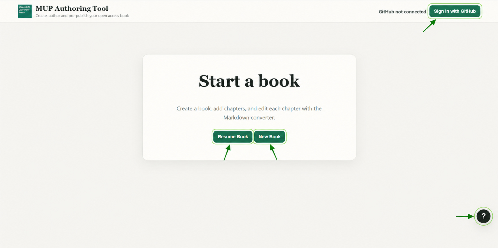
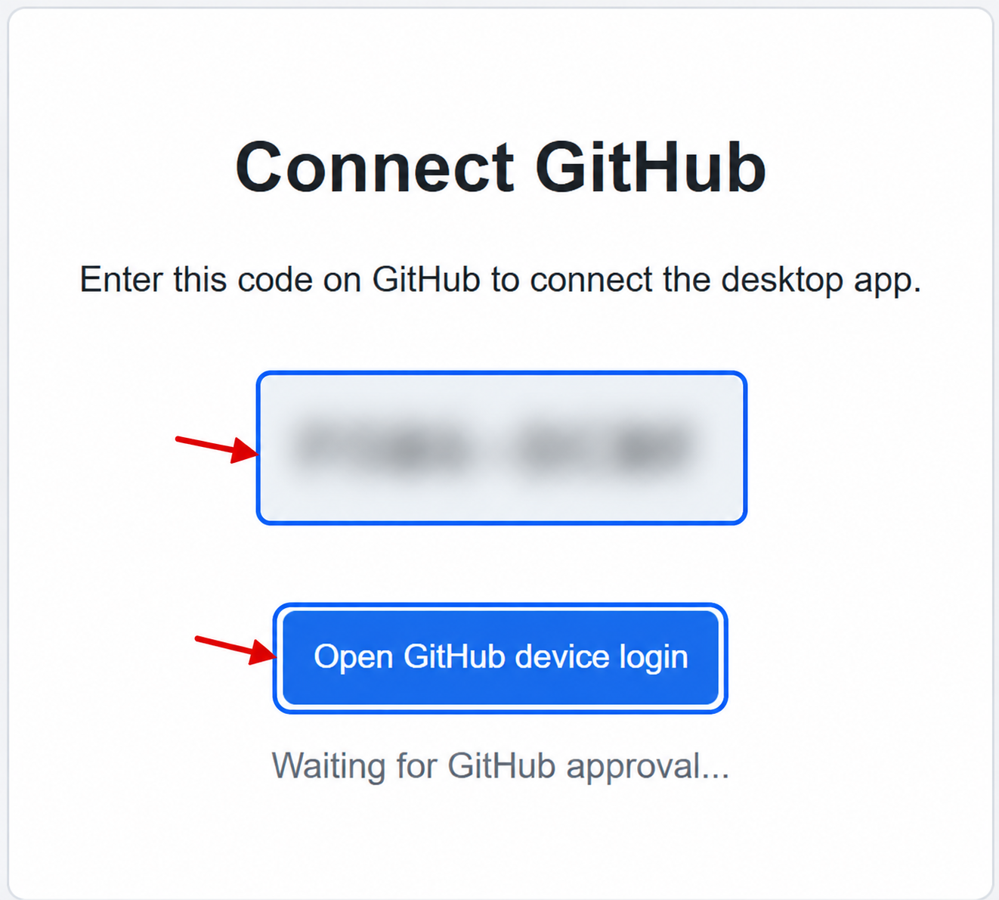
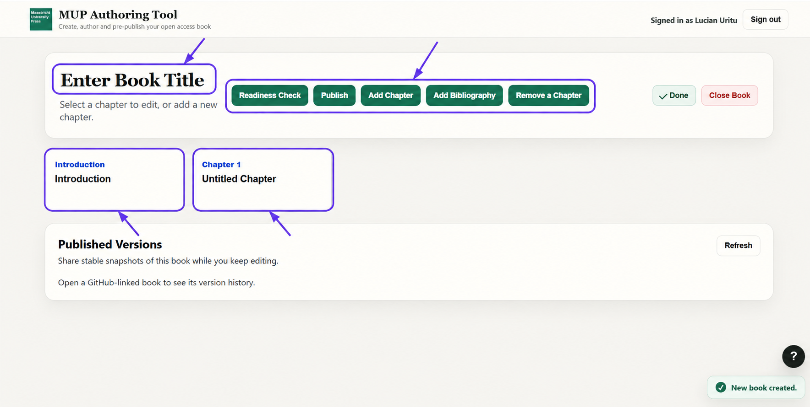
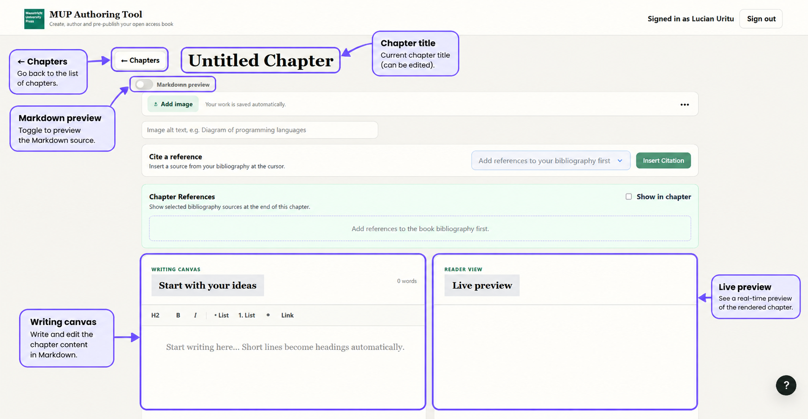
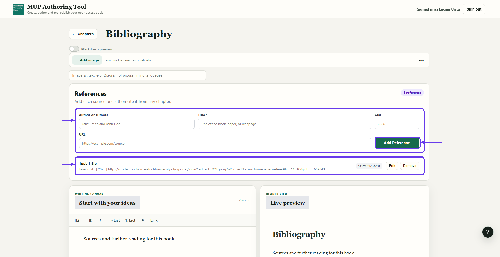
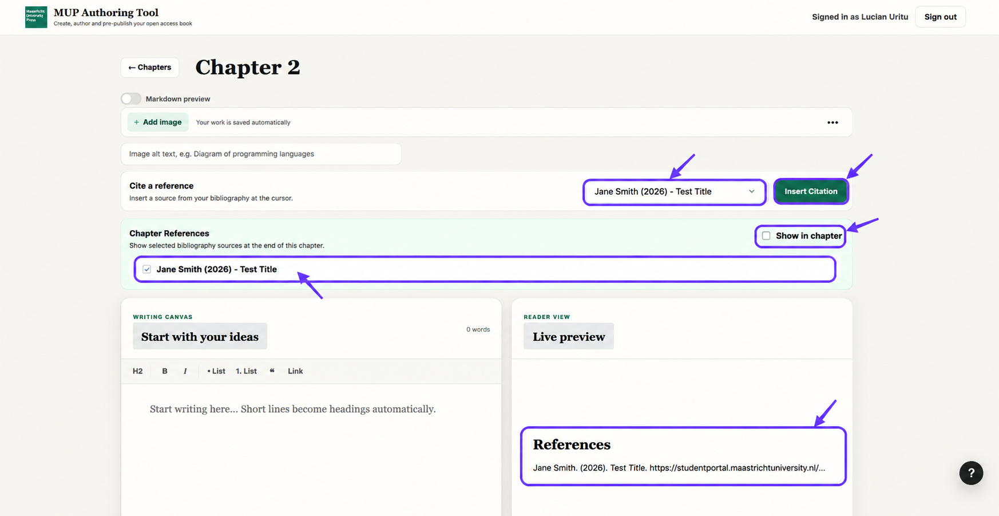
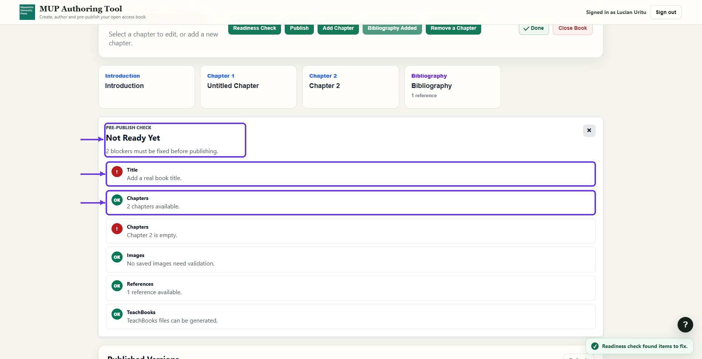

# First Publishing Workflow

This guide takes you from opening the app to sharing your first published book version. Follow the steps in order. No technical skills needed!

We'll use **"My First TeachBook"** as the example book title and **"first draft"** as the version name. You can use your own names.

---

## Before You Start

You'll need:

- **MUP Authoring** installed and ready to open
- A **GitHub account** with access to your institution's approved GitHub organisation, and an internet connection for publishing
- The organisation administrator must have installed the approved GitHub App and allowed access to the book repositories you will use. Creating a new repository also requires the appropriate organisation permissions
- A book title, an introduction, and some text for at least one chapter
- Original image files and source details if you want to include them

**Already working on a book?** The app keeps one current draft on this computer. Use **Resume Book** on the home page to continue it. **New Book** asks whether to keep or replace an existing draft. Choose **Keep current draft** unless you have preserved the work and want to start over. To keep a text copy, open each section, click **•••**, then **Download .md**. Keep original images and reference details separately; these downloads are individual Markdown files, not a complete book backup. You can also publish work you are ready to share.

**About screenshots:** Each **[image]** line describes a screenshot to add and the controls to outline. The screenshots should use the same example book so readers can follow the changes. The capture list and outstanding release checks are in the [review checklist](FIRST_PUBLISHING_WORKFLOW_REVIEW.md).

---

## Step 1: Open MUP Authoring

1. Open **MUP Authoring** from your computer
2. Look for **"MUP Authoring Tool"** at the top of the window
3. The app opens the home page. If you are already working in a book, click **"Close Book"** to return there; from the editor, click **"← Chapters"** first
4. Click **"?"** if you want to explore the guided tour before starting

**What you should see:** The home page with a **"New Book"** button and the GitHub connection area at the top.

**Close Book** keeps your draft. **Resume Book** appears when a local draft is available and reopens it. Restarting the desktop app opens the home page, where you can resume the saved draft. For this walkthrough, continue with a new book only after preserving any draft you want to keep.


---

## Step 2: Connect Your GitHub Account

1. Click **"Sign in with GitHub"**
2. On the **"Connect GitHub"** page, note the displayed code and click **"Open GitHub device login"**
3. Sign in on GitHub and enter the code displayed in the app
4. Authorise the approved GitHub App when GitHub asks
5. Return to the app's **"Connect GitHub"** page and wait for it to return to the home page

If the code expires, start **Sign in with GitHub** again to get a new code.

**What you should see:** **"Signed in as"** followed by your name. The home page also shows **"GitHub Books"**. Only TeachBooks repositories in the approved organisation that both your account and the GitHub App can access appear here. Personal repositories and repositories in other organisations are unavailable.

An empty list can be normal for a first book. If an existing book is missing or the panel shows an access error, ask the organisation administrator to check the App installation, its selected repositories, and your account's access. Signing in alone does not grant repository access. After access is updated, click **Refresh** in **GitHub Books**, or sign out and reconnect if needed.

If you are already signed in with the correct account, continue to Step 3.


---

## Step 3: Create and Name Your Book

1. Click **"New Book"**
2. If **"Replace current draft?"** appears, choose **"Keep current draft"** to cancel. Choose **"Replace draft"** only if you have preserved the existing work and intend to replace it
3. Click the **"Enter Book Title"** field
4. Replace it with **"My First TeachBook"**, or your own title

You do not need to press Enter or click Save. The title is saved automatically.

Use a distinct title for this test book: its GitHub repository name is based on the title. If someone has already published **My First TeachBook** in your organisation, add a distinguishing word or number.

**What you should see:** Your book title, an **Introduction** card, and a first chapter card.



---

## Step 4: Write Your Introduction

1. Click the **"Introduction"** card
2. Click inside the writing area under **"Start with your ideas"**
3. Replace the sample introduction with your own introduction
4. Check the **Live preview**

**Example:**

```text
Introduction

Welcome to My First TeachBook. This book introduces our topic and explains how to get started.

What You Will Learn

- Understand the main ideas
- Work through a simple example
- Find sources for further reading
```

Start with a heading on the first line. Leave blank lines between paragraphs and sections.

**What you should see:** A formatted introduction in the Live preview. The sample instructions should be gone.

Click **"← Chapters"** when you are ready to continue.



---

## Step 5: Name and Write Your First Chapter

1. Click the first chapter card
2. Change **"Untitled Chapter"** in the top title field to **"Getting Started"**
3. Click inside the writing area
4. Type or paste your chapter content

**Example:**

```text
Getting Started

This chapter explains the first ideas you need to understand before exploring the topic.

The Main Idea

A clear explanation helps readers connect new information to what they already know.

Try It Yourself

1. Read the explanation carefully.
2. Write a short example in your own words.
3. Compare your example with the main idea.

\A short note that stays a paragraph
```

**Tip:** The backslash on the last line keeps a short line from becoming a heading. It will not appear in the output.

**What you should see:** A named chapter with content and a formatted preview.

---

## Step 6: Format and Review Your Text

1. Select a word or phrase in a paragraph and click **B** to make it bold
2. Try **I** for italic text if needed
3. Use **• List**, **1. List**, or **❝** for lists and quotations
4. To add a link, select its wording, click **Link**, and replace the example address with your real address
5. Turn on **"Markdown preview"** if you want to see the generated Markdown
6. Check the Live preview after each change

**What you should see:** The formatting marks in your writing and their result in the preview. You do not need to edit the Markdown output panel.

If a short line becomes an unwanted heading, start it with a backslash. Keep checking the preview as you write.


---

## Step 7: Add an Image, If Needed

You can skip this step for a text-only book.

1. Place your cursor where the image should appear in the writing area
2. Fill in the **Image alt text** field with a useful description
3. Click **"＋ Add image"**
4. Choose the original image file from your computer
5. Check the inserted image text and the Live preview

**Example description:** "Diagram showing the three stages of the learning activity."

**What you should see:** Your image in the preview. The app has saved it with the current book for publishing.

If you add an image again to fix a problem, remove or replace the old broken image text. Keep the original file on your computer too.

---

## Step 8: Add References and Citations, If Needed

You can skip this step if your book does not use sources or citations.

### Add Your Sources

1. Click **"← Chapters"**
2. Click **"Add Bibliography"**
3. Open the **"Bibliography"** card if necessary
4. Fill in the reference's **Author or authors**, **Title**, **Year**, and **URL**
5. Click **"Add Reference"**
6. Repeat for each source

Only the title is required, but complete source details help readers find the original work.

**What you should see:** Your sources in the saved reference list.



### Insert a Citation

1. Return with **"← Chapters"** and open **"Getting Started"**
2. Place your cursor after the sentence that uses a source
3. Choose the source under **"Cite a reference"**
4. Click **"Insert Citation"**
5. Review the citation and the reference list in the Live preview

The app automatically selects that source in **Chapter References** and turns on **"Show in chapter"**.

**What you should see:** A citation in the chapter text and its source in the chapter's references.



---

## Step 9: Finish Your Chapter List

1. Click **"← Chapters"**
2. If you need more chapters, click **"Add Chapter"**
3. Open each new chapter, give it a distinct title, and add content
4. Return to the book page
5. Drag chapter cards into the order you want readers to follow

One chapter is enough for this first publication. Do not add empty chapters just to fill out the list.

If you added an unwanted chapter, click **"Remove a Chapter"**, use its delete control, check the name, and confirm **"Delete chapter"**. Click **"Done Removing"** if removal mode is still active. You must keep at least one chapter.

**What you should see:** The Introduction, all intended chapter cards in order, and a Bibliography card if you added one.


---

## Step 10: Run the Readiness Check

1. Click **"Readiness Check"** on the book page
2. Read the report below the cards
3. If it says **"Not Ready Yet"**, fix each blocker
4. Return and run **"Readiness Check"** again
5. Review any warnings too

Common fixes include adding a real book title, writing content in an empty chapter, giving duplicate chapters different titles, replacing missing images, and fixing citations to missing references.

**What you should see:** **"Ready to Publish"** with no blockers. Warnings do not block publishing, but review them before continuing.

**Remember:** Check spelling, links, sample text, and image descriptions yourself. The readiness check does not review the quality of your writing.



---

## Step 11: Name Your First Published Version

1. Check that you are still signed in with GitHub
2. Click **"Publish"** on the book page
3. In **"Name This Published Version"**, enter **"first draft"**
4. Check the **"Saved as"** line; this example becomes **"version/first-draft"**
5. Click **"Publish this version"**

**What you should see:** The repository visibility choice for a new book.

If the app reports that your GitHub session has expired, sign in again before retrying.

**Tip:** Use a name that has not been used for this book before. Spaces become hyphens, and the names `main` and `master` are not allowed. If you cancel and return later, the Publish button may say **"Publish Book Preview"**.


---

## Step 12: Choose Where the Book Files Will Be Stored

The book files are stored in a GitHub repository in the approved organisation, rather than your personal account. The app chooses the repository name from the book title. For a new book, the **"Create Repository"** dialog offers:

- **Public:** The repository's files will be public
- **Private:** Access to the repository's files will be restricted

For this open-sharing example, click **Public** if your organisation permits it.

**Remember:** This setting controls the repository, not a password for the published website. Do not assume that Private makes the online preview private. Ask your administrator about restricted-reader access before publishing restricted content.

**What you should see:** Publishing starts after you choose a visibility option. A book already linked to GitHub uses its existing repository and skips this dialog.

If repository creation or access is refused, ask the organisation administrator to check your permission to create repositories and the GitHub App's access to the new repository. An installation limited to selected repositories may need the administrator to add this book before publishing can continue. For a private repository, ask them to confirm that GitHub Pages is available under the organisation's plan and settings.


### If You See "Repository Exists"

1. Read the repository name in the message
2. For a separate new book, choose **"Cancel"**
3. Change the book title to something different
4. Repeat Steps 10–12

Use **"Overwrite"** only when you intend to update the book files in the repository shown.


---

## Step 13: Wait for Publishing to Finish

Keep the app open and your internet connection active. Watch the progress through:

1. **Preparing repository**
2. **Enabling GitHub Pages**
3. **Uploading book files**
4. **Waiting for GitHub Action**
5. **Published**

The button may show **"Uploading..."** and then **"Building..."**. The build can take time, so wait for the final result.

**What you should see:** A success message and a **Preview URL** once the build succeeds.

If the app shows a publishing issue, read **"What happened"** and **"What to do next"**. If the build is taking longer than expected, check the repository's **Actions** tab on GitHub. It may still be running. A saved version entry by itself does not confirm a successful build.

If a retry says the version already exists, use a new name after resolving the problem. See the [Publishing and Troubleshooting FAQ](FAQ.md#publishing-and-troubleshooting).


---

## Step 14: Open and Check Your First Published Version

1. Click **"Open"** beside the Preview URL
2. Check the book title and introduction
3. Open each chapter and check the order
4. Review headings, paragraphs, lists, and other formatting
5. Check images, links, citations, and references if you included them

**What you should see:** Your TeachBook online, with the content you prepared.

If the page is not ready, check the build status and try the link again after it finishes. If you find a content mistake, return to the app, correct it, and publish a new version name.
e.

---

## Step 15: Copy and Share the Version Link

1. Return to the app
2. Use **"Copy URL"** if the success panel is still visible. If copying fails, select the **Preview URL** and copy it manually
3. If the panel has disappeared, find **"Published Versions"** on the book page
4. Click **"Refresh"**
5. Find **"first-draft"** and click **"Copy link"**
6. Share that link with your intended readers

The history may show the simplified version name with hyphens. Use **"Open"** beside that version whenever you want to check the link again.

**Open** views the published book. **Use for editing** loads that version into your local draft and replaces the current working copy. Preserve unpublished changes before using it. Opening another book with **Edit** under **GitHub Books** also replaces the local draft; these actions do not use the **New Book** replacement dialog.

**What you should have:** A working link to your first published version.

---

## Step 16: Finish and Return to Your Draft

Your first version is already published. If it is ready for editorial review, share the checked version link with your editor through your usual contact method.

The current **Done** button displays **"Coming in a future update"** and **"The Done feature isn't available yet. It will be added in a future update."** Click **Close** to dismiss it. It does not send an email, submit the book for review, or publish a version. You can finish this walkthrough without clicking it.

To pause work and return later:

1. Return to the book page and click **"Close Book"**
2. Click **"Resume Book"** on the home page when you want to continue
3. If you quit the desktop app instead, open it again and click **"Resume Book"** on the home page

Your edits are saved locally as you work. Publish a new version when you want readers to see later changes.


---

## Your First Version is Ready! 📚

Before finishing, check that:

- ✅ Your introduction and chapters contain your own content
- ✅ The readiness check has no blockers
- ✅ The publishing build succeeded
- ✅ You opened and checked the online book
- ✅ You copied the link for the version you want readers to see

You can keep editing your book. When you are ready to share more changes, publish another version with a new name, such as **"second draft"**.

**Be careful when switching:** **Use for editing** and opening another GitHub book replace the current local working copy. **New Book** offers **Keep current draft** or **Replace draft**. Preserve unpublished changes before replacing a draft; use **Resume Book** to continue the one already saved.

